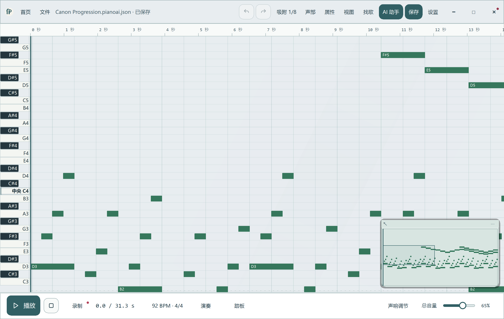

# Flowing Piano

**Play a melody. Shape it on the piano roll. Make it your own.**

A Windows desktop piano and music editor, with optional AI assistance.
Play with your computer keyboard, record ideas, arrange several parts, and
export MIDI or WAV. Playing, editing and saving work without an AI account.

[简体中文](README.zh-CN.md) · [Downloads](https://github.com/qingyv555-byte/flowing-piano-release/releases)
· [Download FAQ](docs/DOWNLOAD-FAQ.md) · [Build from source](docs/BUILD-FROM-SOURCE.md)

## In the editor



## What you can do

- Play and record with the computer keyboard, including sustain controls.
- Edit notes, timing, velocity and musical parts in a piano roll.
- Save projects, undo changes, and export MIDI or WAV.
- Choose a light or dark workspace, background, note colors and music feedback.
- Use the optional AI assistant to discuss a project and prepare editable ideas.
  AI features depend on your configured provider and its supported tools.

## Get started

1. Open [Releases](https://github.com/qingyv555-byte/flowing-piano-release/releases)
   and choose a Windows release. Check the release notes for its status.
2. Use the Setup installer, or extract the Portable ZIP and open
   `AI-Piano-Studio.exe`. Python is not required for packaged versions.
3. Open an example or start a project, play a few notes, then save your work.

Official Windows preview builds are free to download. Each release includes the matching source and SHA-256 checksums. The preview installer is unsigned.

## Run from source

Windows x64 and Python 3.12:

```powershell
.\tools\setup-development-environment.ps1
.\Open-Studio.cmd
```

Built with Python, PySide6 and Qt Quick. Dependency versions are pinned in
`uv.lock`. See [building](docs/BUILD-FROM-SOURCE.md) and
[contributing](CONTRIBUTING.md).

## License

Application code is [GPL-3.0-only](LICENSE). Piano samples, icons and other
third-party material retain their own licenses; see
[third-party notices](THIRD_PARTY_NOTICES.md). Your music does not automatically
become GPL-licensed because you created it with this app.
