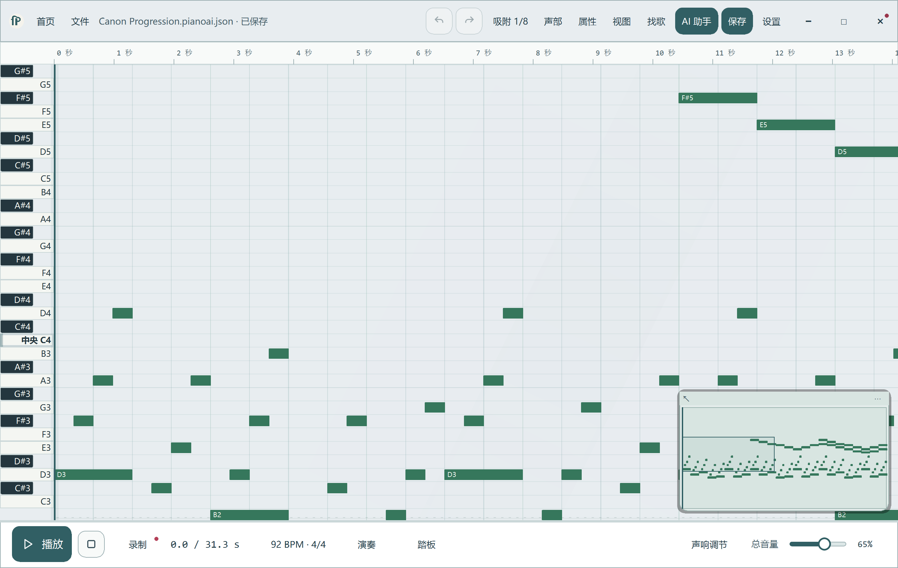

# Flowing Piano

**弹出旋律，在钢琴卷帘里编辑，把想法做成自己的作品。**

面向 Windows 的桌面钢琴与音乐编辑工具。用电脑键盘弹奏、录制片段，
编排多个声部，并导出 MIDI 或 WAV。弹奏、编辑和保存不需要 AI 账号。

[English](README.md) · [下载](https://github.com/qingyv555-byte/flowing-piano-release/releases)
· [下载常见问题](docs/DOWNLOAD-FAQ.md) · [源码构建](docs/BUILD-FROM-SOURCE.md)

## 编辑器预览



## 可以做什么

- 用电脑键盘弹奏与录制，控制延音。
- 在钢琴卷帘中修改音高、节奏、力度和声部。
- 保存工程、撤销修改，导出 MIDI 或 WAV。
- 选择明亮或暗色界面，调整背景、音符颜色与音乐反馈。
- 可选 AI 助手支持讨论当前工程、准备可编辑的创作草稿。
  实际能力取决于所配置的模型服务及其支持的工具。

## 开始使用

1. 在 [Releases](https://github.com/qingyv555-byte/flowing-piano-release/releases)
   选择 Windows 版本，并查看该版本说明。
2. 使用 Setup 安装包，或者解压 Portable ZIP 后运行 `AI-Piano-Studio.exe`。
   打包版本不需要自行安装 Python。
3. 打开示例或新建作品，弹奏、编辑，然后保存工程。

官方 Windows 预览版免费下载。每次发布附对应源码和 SHA-256 校验值。本次预览安装包未签名。

## 从源码运行

Windows x64、Python 3.12：

```powershell
.\tools\setup-development-environment.ps1
.\Open-Studio.cmd
```

使用 Python / PySide6 / Qt Quick；依赖版本固定在 `uv.lock`。
详细步骤见[构建说明](docs/BUILD-FROM-SOURCE.md)。

## 许可

程序代码采用 [GPL-3.0-only](LICENSE)。音源、图标等内容保留各自许可，见
[第三方声明](THIRD_PARTY_NOTICES.md)。你创作的音乐不会因使用本软件而自动采用 GPL。
